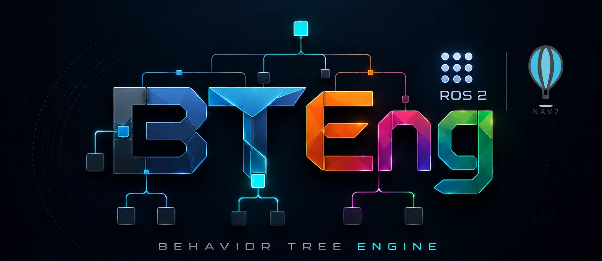

<p align="center">
  
</p>

# bteng-nav2

[](https://pypi.org/project/bteng-nav2/)
[](https://www.python.org/)
[](LICENSE)
[](pyproject.toml)
[](https://pypi.org/project/bteng/)
[](https://pypi.org/project/bteng-ros2/)

Nav2 behavior tree nodes for the [BTEng](https://pypi.org/project/bteng/) engine.

A pure Python pip library — no ROS 2 workspace, no colcon, no XML behavior trees required.
Every Nav2 action server, service, and common condition is available as a composable BTEng node.

## Install

```bash
source /opt/ros/jazzy/setup.bash   # or kilted / rolling
pip install bteng-nav2
```

`bteng` and `bteng-ros2` are pulled in automatically (bteng ≥ 0.3.2, bteng-ros2 ≥ 0.3.0).

> [!IMPORTANT]
> Python ≥ 3.12, so **Humble and Iron are not supported** — both ship Python 3.10.
> Jazzy onward (Ubuntu 24.04, Python 3.12) is the supported range.

---

## Run a tree with one command

A project needs **no application Python** — a params file, a tree, and one command:

```yaml
# params.yaml
ros:
  namespace: ""
  use_sim_time: false
blackboard:
  goal_pose:   {type: pose, frame_id: map, x: 2.0, y: 1.5, yaw: 0.0}
  backup_dist: 0.30
```

```xml
<!-- trees/navigate.xml -->
<BTEng format_version="1.0" main_tree_to_execute="main">
  <Tree ID="main">
    <Fallback name="navigate_with_recovery">
      <NavigateToPose name="attempt" goal_pose="{goal_pose}" result="{nav_result}" />
      <Sequence name="recover_and_retry">
        <ClearGlobalCostmap name="clear" />
        <BackUp name="back_off" backup_dist="{backup_dist}" />
        <NavigateToPose name="retry" goal_pose="{goal_pose}" />
      </Sequence>
    </Fallback>
  </Tree>
</BTEng>
```

```bash
bteng-nav2 run trees/ -p params.yaml              # run every tree in the directory
bteng-nav2 run trees/ -p params.yaml --dry-run    # parse + build only: CI gate, no robot
bteng-nav2 run trees/ -p params.yaml --namespace /robot1
bteng-nav2 nodes                                  # list every XML tag
```

Poses are built in the YAML because a BT XML attribute is a string and `NavigateToPose` wants a
`geometry_msgs/PoseStamped`. Every node is available under two XML tags — the short form
(`NavigateToPose`) and the class name (`NavigateToPoseNode`). Exit code is 0 only if every tree
succeeded. Full reference: [docs/guide/cli.md](docs/guide/cli.md).

Prefer to build the tree in Python? That still works — see [Building Trees](docs/guide/building-trees.md).

### Pointing nodes at your stack

Every action, service and condition node carries its endpoint as a port, so a second planner, a
second sensor or a renamed service is a tree change rather than a subclass:

```xml
<ComputePathToPose name="plan_b" goal="{goal}" path="{path_b}"
                   action_name="/planner_b/compute_path_to_pose" />
<IsObstacleNear    name="rear"   topic_name="/scan_rear" min_distance="0.4" />
```

Defaults are unchanged when you say nothing, and `--namespace` rewrites every absolute endpoint for
multi-robot. Details and the two exceptions: [Retargeting endpoints](docs/guide/endpoints.md).

---

## What's included

### Actions → `RosActionNode`

| Node | Nav2 server | Ports IN | Ports OUT |
|---|---|---|---|
| `NavigateToPoseNode` | `/navigate_to_pose` | `goal_pose`, `behavior_tree=""` | `result` |
| `NavigateThroughPosesNode` | `/navigate_through_poses` | `poses`, `behavior_tree=""` | `result` |
| `ComputePathToPoseNode` | `/compute_path_to_pose` | `goal`, `start=None`, `planner_id=""` | `path` |
| `ComputePathThroughPosesNode` | `/compute_path_through_poses` | `goals`, `start=None`, `planner_id=""` | `path` |
| `FollowPathNode` | `/follow_path` | `path`, `controller_id=""`, `goal_checker_id=""` | — |
| `SmoothPathNode` | `/smooth_path` | `path`, `smoother_id=""`, `max_smoothing_duration=10.0` | `smoothed_path` |
| `SpinNode` | `/spin` | `target_yaw`, `time_allowance=10.0` | — |
| `BackUpNode` | `/backup` | `backup_dist=0.15`, `backup_speed=0.025`, `time_allowance=10.0` | — |
| `DriveOnHeadingNode` | `/drive_on_heading` | `dist_to_travel`, `speed`, `time_allowance=10.0` | — |
| `WaitNode` | `/wait` | `wait_duration=1` | — |
| `AssistedTeleopNode` | `/assisted_teleop` | `time_allowance=30.0` | — |
| `DockRobotNode` | `/dock_robot` | `dock_id`, `dock_type=""` | `success` |
| `UndockRobotNode` | `/undock_robot` | `dock_type=""` | — |

### Services → `RosServiceNode`

| Node | Nav2 server | Ports IN | Ports OUT |
|---|---|---|---|
| `ClearGlobalCostmapNode` | `/global_costmap/clear_entirely_global_costmap` | — | — |
| `ClearLocalCostmapNode` | `/local_costmap/clear_entirely_local_costmap` | — | — |
| `ClearGlobalCostmapAroundRobotNode` | `/global_costmap/clear_around_global_costmap` | `reset_distance=1.0` | — |
| `ClearLocalCostmapAroundRobotNode` | `/local_costmap/clear_around_local_costmap` | `reset_distance=1.0` | — |
| `GetGlobalCostmapNode` | `/global_costmap/get_costmap` | — | `costmap` |
| `GetLocalCostmapNode` | `/local_costmap/get_costmap` | — | `costmap` |
| `IsPathValidNode` | `/is_path_valid` | `path` | — (SUCCESS/FAILURE) |
| `LoadMapNode` | `/map_server/load_map` | `map_url` | `result_code` |

### Conditions → `RosConditionNode`

| Node | Source | Logic |
|---|---|---|
| `IsRobotNearGoalCondition` | `/amcl_pose` | Euclidean distance to `goal_pose` < `tolerance=0.5` |
| `IsLocalizationActiveCondition` | `/amcl_pose` | Message received within `timeout=2.0` s |
| `IsObstacleNearCondition` | `/scan` | `min(ranges)` < `min_distance=0.5` |
| `IsStuckCondition` | `/odom` | Velocity ≈ 0 for > `stuck_timeout=3.0` s |
| `IsGoalUpdatedCondition` | Blackboard | `goal_pose` key changed since last tick |
| `IsNavigationActiveCondition` | Action server | `/navigate_to_pose` server is available |

### Publishers → `RosTopicMixin`

| Node | Topic | Message |
|---|---|---|
| `PublishGoalPoseNode` | `/goal_pose` | `geometry_msgs/PoseStamped` |
| `SetInitialPoseNode` | `/initialpose` | `geometry_msgs/PoseWithCovarianceStamped` |

---

## Usage

### Navigate to a pose

```python
import rclpy
from bteng import Blackboard, ExecutorConfig, NodeConfig, Tree, TreeMetadata
from bteng_ros2 import RosBTExecutor
from bteng_nav2 import NavigateToPoseNode

rclpy.init()

bb = Blackboard()
bb.set("goal_pose", make_pose(x=2.0, y=1.5))

config = NodeConfig(blackboard=bb, input_ports={"goal_pose": "goal_pose"})
root = NavigateToPoseNode("navigate", config=config)

# Tree takes its metadata first; RosBTExecutor is itself an rclpy node and
# injects itself into every ROS-aware node, so none of them need a ros_node.
tree = Tree(TreeMetadata(id="navigate"), root)
bt = RosBTExecutor(tree, ExecutorConfig(tick_interval=0.05))
status = bt.run(timeout=120.0)     # spins until the tree settles

bt.destroy_node()
rclpy.shutdown()
```

### Compute path then follow it

Wire the output of one node to the input of another through the blackboard:

```python
from bteng import SequenceNode, NodeConfig, Blackboard
from bteng_nav2 import ComputePathToPoseNode, FollowPathNode

bb = Blackboard()
bb.set("goal", goal_pose)

compute_cfg = NodeConfig(
    blackboard=bb,
    input_ports={"goal": "goal"},
    output_ports={"path": "path"},
)
follow_cfg = NodeConfig(
    blackboard=bb,
    input_ports={"path": "path"},
)

root = SequenceNode("root", children=[
    ComputePathToPoseNode("compute", config=compute_cfg),
    FollowPathNode("follow", config=follow_cfg),
])
```

### Recovery tree

```python
from bteng import FallbackNode, SequenceNode
from bteng_nav2 import (
    NavigateToPoseNode, ClearGlobalCostmapNode, BackUpNode, SpinNode
)

root = FallbackNode("root", children=[
    NavigateToPoseNode("navigate", config=nav_cfg),
    SequenceNode("recovery", children=[
        ClearGlobalCostmapNode("clear", config=cfg),
        BackUpNode("back_up", config=cfg),
        SpinNode("spin", config=cfg),
        NavigateToPoseNode("retry", config=nav_cfg),
    ]),
])
```

### Full autonomy with conditions

```python
from bteng import FallbackNode, SequenceNode
from bteng_nav2 import (
    IsLocalizationActiveCondition,
    IsRobotNearGoalCondition,
    IsNavigationActiveCondition,
    NavigateToPoseNode,
    ClearGlobalCostmapNode,
    SpinNode,
)

root = FallbackNode("root", children=[
    SequenceNode("pre_checks", children=[
        IsLocalizationActiveCondition("localized", config=cfg),
        IsRobotNearGoalCondition("near_goal", config=cfg),  # already there
    ]),
    SequenceNode("navigate", children=[
        IsNavigationActiveCondition("nav_ready", config=cfg),
        NavigateToPoseNode("go", config=cfg),
    ]),
    SequenceNode("recover", children=[
        ClearGlobalCostmapNode("clear", config=cfg),
        SpinNode("spin", config=cfg),
    ]),
])
```

---

## Design

`bteng-nav2` follows the same mixin pattern as `bteng-ros2`:

- **Action nodes** subclass `RosActionNode` and implement `make_goal()`. All nav2 action lifecycle (send, poll, cancel) is handled.
- **Service nodes** subclass `RosServiceNode` and implement `make_request()`. Response handling goes in `on_response()`.
- **Condition nodes** subclass `RosConditionNode` and implement `evaluate(msg)`. Subscriptions are created lazily on the first tick.
- **Publisher nodes** mix `RosTopicMixin` with `ActionNode`. Publishers are created lazily and reused.

All ROS message imports are **lazy** (inside methods), so the package imports cleanly without a ROS installation — enabling unit testing via standard `pytest`.

---

## Testing without ROS 2

The test suite runs fully offline:

```bash
python -m venv .venv && source .venv/bin/activate
pip install -e ".[dev]"
pytest
```

`test/conftest.py` stubs all ROS 2 and Nav2 message types so no ROS installation is needed.

---

## Examples

| File | Demonstrates |
|---|---|
| `examples/01_navigate_to_pose.py` | Single goal navigation |
| `examples/02_compute_and_follow.py` | Path planning + path following pipeline |
| `examples/03_patrol_loop.py` | Multi-waypoint patrol loop |
| `examples/04_recovery_tree.py` | Navigation with costmap clear + backup fallback |
| `examples/05_full_autonomy.py` | Localization check, goal check, navigation, recovery |

Run any example after sourcing ROS 2:

```bash
source /opt/ros/humble/setup.bash
python examples/01_navigate_to_pose.py
```

---

## Requirements

- Python ≥ 3.12
- ROS 2 Jazzy / Kilted / Rolling (Humble and Iron are Python 3.10 — see Install)
- `bteng >= 0.3.2` (behaviour floor is 0.3.1; 0.3.2 is the first requiring Python 3.12)
- `bteng-ros2 >= 0.3.0` (behaviour floor is 0.2.3, likewise)
- `pyyaml >= 5.4`
- Nav2 (`nav2_msgs`, `nav_msgs`, `sensor_msgs`, `geometry_msgs`)

---

## License

MIT
